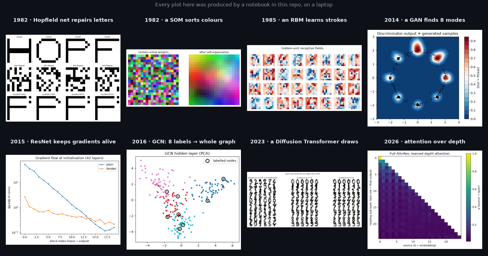
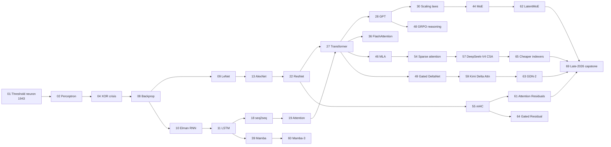

<div align="center">

# 🧠 Neural Networks, 1943 → 2026

### 83 years of deep learning. 69 notebooks. One laptop.

**Re-live the history of neural networks by building it, from a 1943 logic neuron to the architectures inside November 2026's frontier LLMs.**




**[▶ Run notebook 01 in Colab](https://colab.research.google.com/github/babushkai/neuralnetwork/blob/main/notebooks/01_1943_mcculloch_pitts_neuron.ipynb)** · **[▶ Jump to 2026: Kimi Delta Attention](https://colab.research.google.com/github/babushkai/neuralnetwork/blob/main/notebooks/59_2026_kimi_delta_attention.ipynb)** · **[📚 Browse the timeline](#-the-timeline)** · **[🧭 Pick a track](#-pick-your-path)**

</div>

---

Most deep-learning tutorials start in 2017 and stop at "now call `AutoModel.from_pretrained`". This repo starts with **McCulloch and Pitts wiring logic gates out of threshold units** and ends with **the Gated DeltaNet-2 layers, LatentMoE experts and attention-over-depth residuals** that shipped in open-weight models months ago.

> **The whole history of the field, as code you can run.** No slides, no hand-waving, no pretrained black boxes. Just 69 notebooks, each one an idea you can break, tweak and re-run in minutes.

Every one of the 69 notebooks:

| | |
|---|---|
| 📜 **Reads the paper** | the idea, the key equations, and why it mattered at the time |
| 🔧 **Builds it from scratch** | NumPy for the classics, plain PyTorch afterwards. No `nn.Transformer`, no model hubs |
| 🏋️ **Trains it** | on a task small enough for a laptop, with no dataset downloads |
| 🔬 **Shows the result, honestly** | when a toy can't reproduce a paper's at-scale effect, the notebook says so instead of faking it |

Open any notebook, press *Run All*, and watch an idea work.

### Why this and not another course?

| | typical course / blog series | paper-implementation repos | **this repo** |
|---|---|---|---|
| covers 1943 → today in one continuous arc | ❌ | ❌ | ✅ |
| includes designs from the last 6 months (DeepSeek-V4.1, Kimi K3, Nemotron 3, Qwen3.8) | ❌ | rarely | ✅ |
| runs offline on a laptop, no GPU needed | sometimes | rarely | ✅ |
| one standalone notebook per idea, with the math *and* a training run | sometimes | ✅ | ✅ |
| says so when a toy result doesn't match the paper | rarely | rarely | ✅ |

---

## ⚡ Moments you'll see for yourself

Real outputs from the committed notebooks, not paper claims:

| | what happens | notebook |
|---|---|---|
| 🚫 | No straight line can solve XOR: the best single threshold unit tops out at **75%**. One hidden layer plus backprop solves it exactly. | [04](notebooks/04_1969_xor_problem.ipynb) → [08](notebooks/08_1986_backpropagation_mlp.ipynb) |
| 🧱 | A plain 42-layer network collapses to **78%** test accuracy; add skip connections and the same depth hits **99.2%**. | [22 ResNet](notebooks/22_2015_resnet.ipynb) |
| 🕸️ | With only **8 labelled nodes**, an MLP gets 43%; a graph convolution, which also reads the edges, gets **99.6%**. | [26 GCN](notebooks/26_2016_graph_convolutional_network.ipynb) |
| 🎯 | CLIP classifies digits **zero-shot, from text prompts alone**, at **99.7%**. | [34 CLIP](notebooks/34_2021_clip.ipynb) |
| 🧮 | FlashAttention gives *the same answer* (error ~1e-6) while never holding more than a **256× smaller** block of the attention matrix. | [36](notebooks/36_2022_flash_attention.ipynb) |
| 🐍 | On selective copying, Mamba's input-dependent state reaches **74.5%** while a classic time-invariant SSM sits at 14.9%, near chance. | [39 Mamba](notebooks/39_2023_mamba_selective_ssm.ipynb) |
| 🚀 | A draft model **72× smaller** than the target lets speculative decoding emit up to **1.77 tokens per big-model call**, with samples from exactly the target distribution. | [40](notebooks/40_2023_speculative_decoding.ipynb) |
| 📉 | A KAN with **150 parameters** fits $e^{\sin \pi x + y^2}$ 4× more accurately than a **4,417-parameter** MLP. | [45 KAN](notebooks/45_2024_kan.ipynb) |
| 🗜️ | DeepSeek's multi-head latent attention caches **48 floats per token** where standard attention needs 256, and weight absorption reproduces the outputs exactly. | [46 MLA](notebooks/46_2024_multi_head_latent_attention.ipynb) |
| 🤔 | GRPO, with reinforcement learning from a checkable reward alone, takes a policy from **4% → 89%** success on a digit-sum puzzle. | [48 GRPO](notebooks/48_2025_grpo_reasoning_rl.ipynb) |
| 🔎 | Local-only attention can't retrieve beyond its window (16%); one global layer fixes it (**100%**). DeepSeek Sparse Attention then reads only a quarter of the keys: 31% with an untrained indexer → **99.9%** after distillation. | [54](notebooks/54_2026_sparse_and_hybrid_attention.ipynb) |
| 🧭 | Attention with *no position encoding* fails a lag-7 copy (18%). Put one Kimi Delta Attention layer underneath, as in Kimi K3, and it reaches **97%**: the recurrent layer supplies position. | [59 KDA](notebooks/59_2026_kimi_delta_attention.ipynb) |
| 📏 | Under PreNorm the residual stream swells **2.3×** over 24 sub-layers; Kimi's Attention Residuals keep it bounded. | [61 AttnRes](notebooks/61_2026_attention_residuals.ipynb) |

---

## 🌳 The family tree

How the ideas descend from each other. Every box is a notebook.



---

## 🧭 Pick your path

Don't want to do all 69 in order? Take a track.

| track | for you if… | notebooks |
|---|---|---|
| ☕ **The espresso tour** (an afternoon) | you want the whole arc, fast | 02 → 04 → 08 → 22 → 27 → 28 → 39 → 54 → 69 |
| 🤖 **Build an LLM, 2018 → 2026** | you work with LLMs and want to know what's inside | 27 → 28 → 30 → 53 → 44 → 46 → 47 → 50 → 58 → 69 |
| 📜 **Long context without quadratic cost** | you care about 1M-token contexts | 36 → 39 → 49 → 54 → 57 → 59 → 60 → 63 → 65 → 66 |
| 🎨 **Generative models** | images, sound and samples from noise | 07 → 15 → 17 → 25 → 33 → 37 → 41 → 52 |
| 🧪 **Training & optimization** | the "how", not the "what" | 08 → 20 → 21 → 24 → 35 → 42 → 53 → 55 → 68 |
| 🎲 **Learning from rewards** | RL, preferences and reasoning | 16 → 38 → 48 → 51 → 67 |

---

## 📚 The timeline

### 🏛️ Foundations (1943–1997): *can machines learn at all?*
| # | Year | Notebook | The idea | Run |
|---|---|---|---|---|
| 01 | 1943 | [McCulloch–Pitts neuron](notebooks/01_1943_mcculloch_pitts_neuron.ipynb) | threshold logic units | [](https://colab.research.google.com/github/babushkai/neuralnetwork/blob/main/notebooks/01_1943_mcculloch_pitts_neuron.ipynb) |
| 02 | 1958 | [Perceptron](notebooks/02_1958_perceptron.ipynb) | the first learning rule, convergence theorem | [](https://colab.research.google.com/github/babushkai/neuralnetwork/blob/main/notebooks/02_1958_perceptron.ipynb) |
| 03 | 1960 | [ADALINE / LMS](notebooks/03_1960_adaline.ipynb) | gradient descent on squared error | [](https://colab.research.google.com/github/babushkai/neuralnetwork/blob/main/notebooks/03_1960_adaline.ipynb) |
| 04 | 1969 | [The XOR problem](notebooks/04_1969_xor_problem.ipynb) | the limits of single layers, the first AI winter | [](https://colab.research.google.com/github/babushkai/neuralnetwork/blob/main/notebooks/04_1969_xor_problem.ipynb) |
| 05 | 1982 | [Hopfield network](notebooks/05_1982_hopfield_network.ipynb) | energy-based associative memory | [](https://colab.research.google.com/github/babushkai/neuralnetwork/blob/main/notebooks/05_1982_hopfield_network.ipynb) |
| 06 | 1982 | [Self-organizing map](notebooks/06_1982_self_organizing_map.ipynb) | competitive, topology-preserving learning | [](https://colab.research.google.com/github/babushkai/neuralnetwork/blob/main/notebooks/06_1982_self_organizing_map.ipynb) |
| 07 | 1985 | [Boltzmann machine / RBM](notebooks/07_1985_boltzmann_machine_rbm.ipynb) | stochastic generative nets, contrastive divergence | [](https://colab.research.google.com/github/babushkai/neuralnetwork/blob/main/notebooks/07_1985_boltzmann_machine_rbm.ipynb) |
| 08 | 1986 | [Backpropagation](notebooks/08_1986_backpropagation_mlp.ipynb) | the MLP and the chain rule, in NumPy | [](https://colab.research.google.com/github/babushkai/neuralnetwork/blob/main/notebooks/08_1986_backpropagation_mlp.ipynb) |
| 09 | 1989 | [LeNet CNN](notebooks/09_1989_lenet_cnn.ipynb) | convolution, weight sharing, pooling | [](https://colab.research.google.com/github/babushkai/neuralnetwork/blob/main/notebooks/09_1989_lenet_cnn.ipynb) |
| 10 | 1990 | [Elman RNN](notebooks/10_1990_elman_rnn.ipynb) | recurrence, BPTT | [](https://colab.research.google.com/github/babushkai/neuralnetwork/blob/main/notebooks/10_1990_elman_rnn.ipynb) |
| 11 | 1997 | [LSTM](notebooks/11_1997_lstm.ipynb) | gated memory vs vanishing gradients | [](https://colab.research.google.com/github/babushkai/neuralnetwork/blob/main/notebooks/11_1997_lstm.ipynb) |

### 🔥 The deep learning revival (2006–2016): *depth, data, GPUs*
| # | Year | Notebook | The idea | Run |
|---|---|---|---|---|
| 12 | 2006 | [Deep autoencoder](notebooks/12_2006_deep_autoencoder.ipynb) | greedy layer-wise pre-training | [](https://colab.research.google.com/github/babushkai/neuralnetwork/blob/main/notebooks/12_2006_deep_autoencoder.ipynb) |
| 13 | 2012 | [AlexNet](notebooks/13_2012_alexnet.ipynb) | ReLU, dropout, augmentation, GPUs | [](https://colab.research.google.com/github/babushkai/neuralnetwork/blob/main/notebooks/13_2012_alexnet.ipynb) |
| 14 | 2013 | [word2vec](notebooks/14_2013_word2vec.ipynb) | skip-gram with negative sampling | [](https://colab.research.google.com/github/babushkai/neuralnetwork/blob/main/notebooks/14_2013_word2vec.ipynb) |
| 15 | 2013 | [VAE](notebooks/15_2013_vae.ipynb) | ELBO, reparameterisation trick | [](https://colab.research.google.com/github/babushkai/neuralnetwork/blob/main/notebooks/15_2013_vae.ipynb) |
| 16 | 2013 | [Deep Q-Network](notebooks/16_2013_deep_q_network.ipynb) | deep RL: experience replay, target networks (CartPole) | [](https://colab.research.google.com/github/babushkai/neuralnetwork/blob/main/notebooks/16_2013_deep_q_network.ipynb) |
| 17 | 2014 | [GAN](notebooks/17_2014_gan.ipynb) | adversarial training, mode collapse | [](https://colab.research.google.com/github/babushkai/neuralnetwork/blob/main/notebooks/17_2014_gan.ipynb) |
| 18 | 2014 | [GRU + seq2seq](notebooks/18_2014_gru_seq2seq.ipynb) | encoder–decoder, the fixed-vector bottleneck | [](https://colab.research.google.com/github/babushkai/neuralnetwork/blob/main/notebooks/18_2014_gru_seq2seq.ipynb) |
| 19 | 2014 | [Bahdanau attention](notebooks/19_2014_bahdanau_attention.ipynb) | additive attention, alignments | [](https://colab.research.google.com/github/babushkai/neuralnetwork/blob/main/notebooks/19_2014_bahdanau_attention.ipynb) |
| 20 | 2014 | [Adam & optimizers](notebooks/20_2014_adam_optimizers.ipynb) | SGD → momentum → RMSProp → Adam → AdamW | [](https://colab.research.google.com/github/babushkai/neuralnetwork/blob/main/notebooks/20_2014_adam_optimizers.ipynb) |
| 21 | 2015 | [Batch normalization](notebooks/21_2015_batchnorm.ipynb) | normalising activations | [](https://colab.research.google.com/github/babushkai/neuralnetwork/blob/main/notebooks/21_2015_batchnorm.ipynb) |
| 22 | 2015 | [ResNet](notebooks/22_2015_resnet.ipynb) | residual connections, the degradation problem | [](https://colab.research.google.com/github/babushkai/neuralnetwork/blob/main/notebooks/22_2015_resnet.ipynb) |
| 23 | 2015 | [U-Net](notebooks/23_2015_unet.ipynb) | encoder–decoder with skips, segmentation | [](https://colab.research.google.com/github/babushkai/neuralnetwork/blob/main/notebooks/23_2015_unet.ipynb) |
| 24 | 2015 | [Knowledge distillation](notebooks/24_2015_knowledge_distillation.ipynb) | dark knowledge, teacher → student | [](https://colab.research.google.com/github/babushkai/neuralnetwork/blob/main/notebooks/24_2015_knowledge_distillation.ipynb) |
| 25 | 2016 | [WaveNet](notebooks/25_2016_wavenet.ipynb) | dilated causal convolutions, raw audio | [](https://colab.research.google.com/github/babushkai/neuralnetwork/blob/main/notebooks/25_2016_wavenet.ipynb) |
| 26 | 2016 | [Graph convolutional network](notebooks/26_2016_graph_convolutional_network.ipynb) | message passing, over-smoothing | [](https://colab.research.google.com/github/babushkai/neuralnetwork/blob/main/notebooks/26_2016_graph_convolutional_network.ipynb) |

### ⚡ Transformers and scale (2017–2022): *attention is all you need*
| # | Year | Notebook | The idea | Run |
|---|---|---|---|---|
| 27 | 2017 | [Transformer](notebooks/27_2017_transformer.ipynb) | multi-head attention, encoder–decoder | [](https://colab.research.google.com/github/babushkai/neuralnetwork/blob/main/notebooks/27_2017_transformer.ipynb) |
| 28 | 2018 | [GPT](notebooks/28_2018_gpt.ipynb) | decoder-only next-token prediction | [](https://colab.research.google.com/github/babushkai/neuralnetwork/blob/main/notebooks/28_2018_gpt.ipynb) |
| 29 | 2018 | [BERT](notebooks/29_2018_bert.ipynb) | masked LM pre-training + fine-tuning | [](https://colab.research.google.com/github/babushkai/neuralnetwork/blob/main/notebooks/29_2018_bert.ipynb) |
| 30 | 2020 | [Scaling laws](notebooks/30_2020_scaling_laws.ipynb) | power laws, Chinchilla IsoFLOP curves | [](https://colab.research.google.com/github/babushkai/neuralnetwork/blob/main/notebooks/30_2020_scaling_laws.ipynb) |
| 31 | 2020 | [SimCLR](notebooks/31_2020_simclr_self_supervised.ipynb) | self-supervised contrastive learning | [](https://colab.research.google.com/github/babushkai/neuralnetwork/blob/main/notebooks/31_2020_simclr_self_supervised.ipynb) |
| 32 | 2020 | [Vision Transformer](notebooks/32_2020_vision_transformer.ipynb) | image patches as tokens | [](https://colab.research.google.com/github/babushkai/neuralnetwork/blob/main/notebooks/32_2020_vision_transformer.ipynb) |
| 33 | 2020 | [DDPM diffusion](notebooks/33_2020_ddpm_diffusion.ipynb) | denoising diffusion | [](https://colab.research.google.com/github/babushkai/neuralnetwork/blob/main/notebooks/33_2020_ddpm_diffusion.ipynb) |
| 34 | 2021 | [CLIP](notebooks/34_2021_clip.ipynb) | contrastive image–text, zero-shot | [](https://colab.research.google.com/github/babushkai/neuralnetwork/blob/main/notebooks/34_2021_clip.ipynb) |
| 35 | 2021 | [LoRA](notebooks/35_2021_lora.ipynb) | low-rank adaptation | [](https://colab.research.google.com/github/babushkai/neuralnetwork/blob/main/notebooks/35_2021_lora.ipynb) |
| 36 | 2022 | [FlashAttention](notebooks/36_2022_flash_attention.ipynb) | tiled exact attention, online softmax | [](https://colab.research.google.com/github/babushkai/neuralnetwork/blob/main/notebooks/36_2022_flash_attention.ipynb) |
| 37 | 2022 | [Flow matching](notebooks/37_2022_flow_matching.ipynb) | rectified flow, reflow | [](https://colab.research.google.com/github/babushkai/neuralnetwork/blob/main/notebooks/37_2022_flow_matching.ipynb) |

### 🤖 The LLM era (2023–2025): *alignment, efficiency, reasoning*
| # | Year | Notebook | The idea | Run |
|---|---|---|---|---|
| 38 | 2023 | [RLHF → DPO](notebooks/38_2023_dpo_preference_optimization.ipynb) | preference optimisation without RL | [](https://colab.research.google.com/github/babushkai/neuralnetwork/blob/main/notebooks/38_2023_dpo_preference_optimization.ipynb) |
| 39 | 2023 | [Mamba](notebooks/39_2023_mamba_selective_ssm.ipynb) | selective state spaces, parallel scan | [](https://colab.research.google.com/github/babushkai/neuralnetwork/blob/main/notebooks/39_2023_mamba_selective_ssm.ipynb) |
| 40 | 2023 | [Speculative decoding](notebooks/40_2023_speculative_decoding.ipynb) | draft + verify, exact sampling | [](https://colab.research.google.com/github/babushkai/neuralnetwork/blob/main/notebooks/40_2023_speculative_decoding.ipynb) |
| 41 | 2023 | [Diffusion Transformer](notebooks/41_2023_diffusion_transformer.ipynb) | DiT, adaLN-Zero, classifier-free guidance | [](https://colab.research.google.com/github/babushkai/neuralnetwork/blob/main/notebooks/41_2023_diffusion_transformer.ipynb) |
| 42 | 2023 | [Quantization](notebooks/42_2023_quantization.ipynb) | int8/int4, outliers, GPTQ | [](https://colab.research.google.com/github/babushkai/neuralnetwork/blob/main/notebooks/42_2023_quantization.ipynb) |
| 43 | 2023 | [Vision-language model](notebooks/43_2023_vision_language_model.ipynb) | LLaVA: encoder → projector → LLM | [](https://colab.research.google.com/github/babushkai/neuralnetwork/blob/main/notebooks/43_2023_vision_language_model.ipynb) |
| 44 | 2017→2024 | [Mixture of Experts](notebooks/44_2023_mixture_of_experts.ipynb) | top-k routing, load balancing | [](https://colab.research.google.com/github/babushkai/neuralnetwork/blob/main/notebooks/44_2023_mixture_of_experts.ipynb) |
| 45 | 2024 | [KAN](notebooks/45_2024_kan.ipynb) | learnable spline activations on edges | [](https://colab.research.google.com/github/babushkai/neuralnetwork/blob/main/notebooks/45_2024_kan.ipynb) |
| 46 | 2024 | [Multi-head Latent Attention](notebooks/46_2024_multi_head_latent_attention.ipynb) | compressed KV cache, weight absorption | [](https://colab.research.google.com/github/babushkai/neuralnetwork/blob/main/notebooks/46_2024_multi_head_latent_attention.ipynb) |
| 47 | 2024 | [Multi-token prediction](notebooks/47_2024_multi_token_prediction.ipynb) | DeepSeek-V3 MTP, self-speculative drafting | [](https://colab.research.google.com/github/babushkai/neuralnetwork/blob/main/notebooks/47_2024_multi_token_prediction.ipynb) |
| 48 | 2025 | [GRPO](notebooks/48_2025_grpo_reasoning_rl.ipynb) | RL with verifiable rewards | [](https://colab.research.google.com/github/babushkai/neuralnetwork/blob/main/notebooks/48_2025_grpo_reasoning_rl.ipynb) |
| 49 | 2025 | [Gated DeltaNet](notebooks/49_2025_gated_deltanet.ipynb) | delta-rule linear attention with gating | [](https://colab.research.google.com/github/babushkai/neuralnetwork/blob/main/notebooks/49_2025_gated_deltanet.ipynb) |
| 50 | 2025 | [Gated attention](notebooks/50_2025_gated_attention.ipynb) | sigmoid output gate, attention sinks | [](https://colab.research.google.com/github/babushkai/neuralnetwork/blob/main/notebooks/50_2025_gated_attention.ipynb) |
| 51 | 2025 | [Tiny Recursive Model](notebooks/51_2025_tiny_recursive_model.ipynb) | recursion + deep supervision | [](https://colab.research.google.com/github/babushkai/neuralnetwork/blob/main/notebooks/51_2025_tiny_recursive_model.ipynb) |
| 52 | 2025 | [Diffusion language model](notebooks/52_2025_diffusion_language_model.ipynb) | LLaDA masked diffusion, infilling | [](https://colab.research.google.com/github/babushkai/neuralnetwork/blob/main/notebooks/52_2025_diffusion_language_model.ipynb) |

### 🛰️ 2026: inside today's frontier models
| # | Notebook | The idea | Seen in | Run |
|---|---|---|---|---|
| 53 | [Modern LLM recipe](notebooks/53_2026_modern_llm_recipe.ipynb) | RMSNorm, RoPE, GQA, QK-norm, SwiGLU, Muon | nearly every 2026 LLM | [](https://colab.research.google.com/github/babushkai/neuralnetwork/blob/main/notebooks/53_2026_modern_llm_recipe.ipynb) |
| 54 | [Sparse & hybrid attention](notebooks/54_2026_sparse_and_hybrid_attention.ipynb) | lightning indexer, local/global hybrids | DeepSeek-V3.2 | [](https://colab.research.google.com/github/babushkai/neuralnetwork/blob/main/notebooks/54_2026_sparse_and_hybrid_attention.ipynb) |
| 55 | [mHC](notebooks/55_2026_manifold_constrained_hyper_connections.ipynb) | manifold-constrained hyper-connections, Sinkhorn | DeepSeek-V4 | [](https://colab.research.google.com/github/babushkai/neuralnetwork/blob/main/notebooks/55_2026_manifold_constrained_hyper_connections.ipynb) |
| 56 | [Engram](notebooks/56_2026_engram_conditional_memory.ipynb) | conditional memory via hashed N-gram lookup | DeepSeek | [](https://colab.research.google.com/github/babushkai/neuralnetwork/blob/main/notebooks/56_2026_engram_conditional_memory.ipynb) |
| 57 | [Compressed sparse attention](notebooks/57_2026_compressed_sparse_attention.ipynb) | CSA + HCA, attention sinks, 1M context | DeepSeek-V4 | [](https://colab.research.google.com/github/babushkai/neuralnetwork/blob/main/notebooks/57_2026_compressed_sparse_attention.ipynb) |
| 58 | [Early-2026 capstone](notebooks/58_2026_frontier_model_capstone.ipynb) | hybrid DeltaNet + gated attention, MoE, MTP, Muon | Qwen3.5-style | [](https://colab.research.google.com/github/babushkai/neuralnetwork/blob/main/notebooks/58_2026_frontier_model_capstone.ipynb) |
| 59 | [Kimi Delta Attention](notebooks/59_2026_kimi_delta_attention.ipynb) | channel-wise gated delta rule, chunkwise algorithm, NoPE | Kimi K3 / K3.1 | [](https://colab.research.google.com/github/babushkai/neuralnetwork/blob/main/notebooks/59_2026_kimi_delta_attention.ipynb) |
| 60 | [Mamba-3](notebooks/60_2026_mamba3.ipynb) 🆕 | trapezoidal discretization, complex state as data-dependent RoPE, MIMO | SSM hybrids | [](https://colab.research.google.com/github/babushkai/neuralnetwork/blob/main/notebooks/60_2026_mamba3.ipynb) |
| 61 | [Attention Residuals](notebooks/61_2026_attention_residuals.ipynb) 🆕 | softmax attention over *depth* instead of a fixed residual sum | Kimi | [](https://colab.research.google.com/github/babushkai/neuralnetwork/blob/main/notebooks/61_2026_attention_residuals.ipynb) |
| 62 | [LatentMoE](notebooks/62_2026_latent_moe.ipynb) 🆕 | experts in a compressed latent space: 4× the experts at the same communication cost | Nemotron 3, Muse Spark | [](https://colab.research.google.com/github/babushkai/neuralnetwork/blob/main/notebooks/62_2026_latent_moe.ipynb) |
| 63 | [Gated DeltaNet-2](notebooks/63_2026_gated_deltanet_2.ipynb) 🆕 | separate channel-wise erase and write gates | NVIDIA | [](https://colab.research.google.com/github/babushkai/neuralnetwork/blob/main/notebooks/63_2026_gated_deltanet_2.ipynb) |
| 64 | [Gated Residual](notebooks/64_2026_gated_residual.ipynb) 🆕 | widened residual, element-wise read gate, scalar write gate | Qwen3.8-Next | [](https://colab.research.google.com/github/babushkai/neuralnetwork/blob/main/notebooks/64_2026_gated_residual.ipynb) |
| 65 | [Cheaper sparse-attention indexers](notebooks/65_2026_cheaper_sparse_attention_indexers.ipynb) 🆕 | block-compressed indexer, index reuse across layers | Qwen3.8, DeepSeek-V4.1 | [](https://colab.research.google.com/github/babushkai/neuralnetwork/blob/main/notebooks/65_2026_cheaper_sparse_attention_indexers.ipynb) |
| 66 | [Causal encoder–decoder](notebooks/66_2026_causal_encoder_decoder.ipynb) 🆕 | encoder-only prefill; decoder KV from the encoder's state | DeepSeek-V4.1-Flash | [](https://colab.research.google.com/github/babushkai/neuralnetwork/blob/main/notebooks/66_2026_causal_encoder_decoder.ipynb) |
| 67 | [Looped transformers](notebooks/67_2026_looped_transformers.ipynb) 🆕 | recurrent depth, test-time loops | Nanbeige4.2, Dory 1.0 | [](https://colab.research.google.com/github/babushkai/neuralnetwork/blob/main/notebooks/67_2026_looped_transformers.ipynb) |
| 68 | [Constant LR + checkpoint averaging](notebooks/68_2026_constant_lr_checkpoint_averaging.ipynb) 🆕 | cosine vs. WSD vs. never decaying | Kolibri-1 | [](https://colab.research.google.com/github/babushkai/neuralnetwork/blob/main/notebooks/68_2026_constant_lr_checkpoint_averaging.ipynb) |
| 69 | [Late-2026 capstone](notebooks/69_2026_late_2026_frontier_capstone.ipynb) 🆕 | GDN-2 + sparse attention + AttnRes + LatentMoE + MTP + Muon, together | all of the above | [](https://colab.research.google.com/github/babushkai/neuralnetwork/blob/main/notebooks/69_2026_late_2026_frontier_capstone.ipynb) |

> **Where's the frontier, honestly?** No single notebook is "the state of the art". The late-2026 open frontier is a *recipe*: mostly linear-memory layers, a few sparse global layers, residual paths that learn to mix depth, and very sparse MoE (69). Labs still disagree on which variant of each piece is best. Closed labs (OpenAI, Anthropic, Google) don't publish their architectures, so only open designs are covered here.

---

## 🚀 Quick start

```bash
git clone https://github.com/babushkai/neuralnetwork && cd neuralnetwork
python -m venv .venv && source .venv/bin/activate     # or: uv venv && source .venv/bin/activate
pip install -r requirements.txt
jupyter lab notebooks/
```

Every PyTorch notebook picks its device automatically: **CUDA → Apple MPS → CPU**. To force one:

```bash
NN_DEVICE=cpu jupyter lab notebooks/
```

**How long does it take?** On an Apple M1 Pro (MPS), most notebooks run in seconds to a few minutes; the heaviest (Mamba, Gated DeltaNet, the 2026 attention notebooks, the capstones) take 5–10 minutes. CPU-only works too: Mamba (39), WaveNet (25), mHC (55), DeepSeek-V4 attention (57) and the capstone (58) take 10–20 minutes, and Kimi Delta Attention (59) about 35. DQN (16) deliberately runs on CPU, which is faster for its tiny networks.

> 🆕 **Fresh off the press:** notebooks **60 and 62–69** are committed **without saved outputs** (they're the newest, and are heavier). Run them yourself; expect roughly 5–20 minutes each on Apple silicon, faster on CUDA. Found a bug? Issues and PRs are very welcome.

---

## 🧰 Under the hood

```
notebooks/      the 69 notebooks (most committed with outputs, so they read like articles on GitHub)
nb_src/         the source of each notebook, in a light "#%% md" / "#%%" cell format that diffs cleanly
tools/
  build.py        nb_src/*.py  ->  notebooks/*.ipynb (expands shared snippets)
  snippets/       shared code: device setup, digits loader, text corpora, a tiny GPT
  run_all.sh      rebuild and execute every notebook in place
  show_outputs.py print the text outputs of executed notebooks
```

To change a notebook, edit `nb_src/<name>.py` and run `python tools/build.py <name>` (this regenerates the `.ipynb`, without outputs), or edit the `.ipynb` directly. `tools/run_all.sh` rebuilds and re-executes everything.

**Design rules the notebooks follow**
- **No magic:** no pretrained weights, no model hubs, no high-level layers that hide the idea being taught.
- **No downloads:** scikit-learn's bundled 8×8 digits, synthetic tasks, and text corpora generated inside the notebook. Clone it on a plane and it works.
- **Standalone:** every notebook runs top to bottom on its own. 01–08 use pure NumPy; from 09 onward, PyTorch.
- **Honest at toy scale:** these are teaching-scale models (tiny networks, small data, short runs). They show the *mechanism*, not leaderboard numbers. When a small model can't show an effect a paper measured at 48B parameters, the notebook says so.

---

## 📖 Sources

Each notebook cites its papers at the top. The 2026 notebooks follow the published designs:
- **DeepSeek:** V4 technical report (arXiv 2606.19348), V4.1-Flash (2609.19969), mHC (2512.24880), Engram (2601.07372), V3.2 sparse attention (2512.02556)
- **Qwen:** gated attention (2505.06708), the Qwen3.5 model card, the Qwen3.8-Next architecture report (2608.30320)
- **Kimi / Moonshot:** Kimi Linear (2510.26692), Attention Residuals (2603.15031)
- **NVIDIA:** Nemotron 3 Super/Ultra (2604.12374, 2606.15007), Gated DeltaNet-2 (2605.22791)
- **Mamba-3** (2603.15569)
- **Sebastian Raschka's 2026 architecture notes:** Kimi K3/K3.1, looped transformers, the October 2026 open-model roundup, and pre-training without LR decay

Where a paper leaves a detail unspecified, the notebook says which choice it made.

---

## 🤝 Contributing

This is a living project: the frontier moves every month, and so will this repo. Contributions that would be great:
- 🐛 **Run the 🆕 notebooks** (60, 62–69) and report or fix anything that breaks
- 🆕 **New milestones:** a recent architecture with a public paper, implemented from scratch at toy scale
- ⚡ **Speed-ups** that keep the code readable, and CPU run-time reports from your machine
- 🌍 **Translations** of the explanations

Edit the source in `nb_src/`, rebuild with `python tools/build.py <name>`, and open a PR.

## 📌 Citation

```bibtex
@misc{neuralnetworks1943to2026,
  title  = {Neural Networks, 1943 to 2026: a runnable history in 69 notebooks},
  author = {babushkai},
  year   = {2026},
  url    = {https://github.com/babushkai/neuralnetwork}
}
```

## 📄 License

[MIT](LICENSE). Use it for courses, study groups, talks and your own experiments.

<div align="center">

**Every architecture here, from 1943 to 2026, is still a weighted sum followed by a nonlinearity.**<br/>
**Come see how far that idea went.**

⭐ **If this repo taught you something, a star helps others find it.** ⭐

</div>
